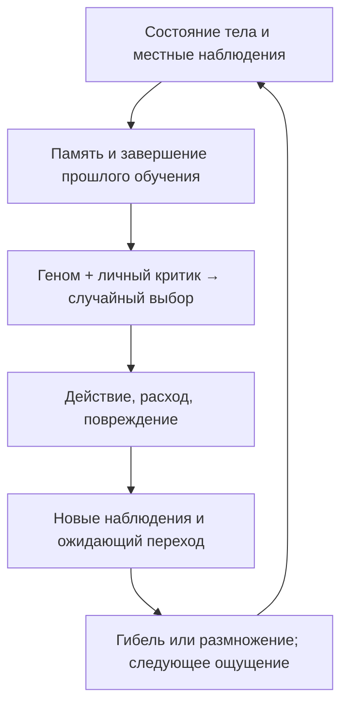

# Навигация по архитектуре

Цель файла — выбрать модуль, а не заменить его чтение. Перед изменением проверяй указанную функцию; номера строк намеренно не фиксируются.

## Главные модули

| Модуль | Ответственность | Входные точки |
| --- | --- | --- |
| [set-brain-inputs.js](../dist/set-brain-inputs.js) | Независимые от весов входы одного решения; жизненный цикл задаётся локальной переменной Evolution | prepareSetDecisionInput |
| [worker-timing.js](../dist/worker-timing.js) | Границы задач/принятых запусков и невложенные фазы Worker, ограниченные гистограммыv3; не CPU-время | WorkerTiming |
| [performance-probe.js](../dist/performance-probe.js) | Необязательный синхронный контекст выбранного шага; без данных мозга | swapComputeProbe, beginComputePart, endComputePart |
| [world-runtime.js](../dist/world-runtime.js) / [world-worker.js](../dist/world-worker.js) | Владелец основного мира и планировщик | handle, pulse, publish |
| [world-view.js](../dist/world-view.js) / [world-client.js](../dist/world-client.js) | Проекция UI и протокол с эпохой/подтверждениями | worldPresentation, WorldView, WorldClient |
| [world-profiler.js](../dist/world-profiler.js) | Worker и отдельные времена UI | WorldProfiler |
| [dist/evolution.js](../dist/evolution.js) | Общий мир, физика тела, варианты и исполнение выбранного id | Evolution.constructor, addAgent, state, evaluate, choose, observe, learnPending, step, reproduce, balances |
| [dist/navigation.js](../dist/navigation.js) | Личная осевая геометрия и проекция для физики/UI | localNeighbours, moveLocally, memoryWorldPosition, rotate |
| [dist/food-settings.js](../dist/food-settings.js) | Границы/проверка пищевых параметров, независимый шаблон и названия старых отчётов | FOOD_LIMITS, validateFoodSettings, createFoodTemplate, foodLabel |
| [dist/help.js](../dist/help.js) | Тексты справки и доступный диалог наблюдателя, без влияния на мозг | HELP, installHelp, createHelpButton |
| [dist/food-islands.js](../dist/food-islands.js) | Индивидуальные группы, точный бюджет, фазы и рост | createIndividualFoodLayout, scheduleFoodIslands, regrowFoodIslands |
| [dist/food-controls.js](../dist/food-controls.js) | Общие поля пищи трёх разделов | readFoodControls, installFoodControls |
| [dist/resident-trail.js](../dist/resident-trail.js) | 20 перемещений только выбранного в UI | ResidentTrail, attachResidentTrail |
| [dist/food-layout.js](../dist/food-layout.js) | Распределение выбранного запаса островками, отдельная случайность | placeFoodIslands, worldDistance |
| [dist/cognition.js](../dist/cognition.js) | Наследуемые свойства мозга, ощущения, наблюдения и личное обучение | cognitiveTraits, wellbeing, createBrain, observe, rememberOutcome, rememberDecision, rememberExperience, memoryEntries, memoryBelief, spatialContext, actionFeatures, learn |
| [dist/evolution-app.js](../dist/evolution-app.js) | Настройки, импорт/экспорт, выбор жителя, карта и панель | settings, restart, update, renderBrain, draw, drawChart, frame |
| [dist/life-history.js](../dist/life-history.js) | Краткие итоги/сводки всех жизней, отдельно от мозга | createLifeCounters, sampleLife, lifeRow, LifeHistory |
| [dist/lab-tabs.js](../dist/lab-tabs.js) | Вкладки, фильтры, пул Workers, экспорт и последний отчёт | installLabTabs, start, dispatch, stop |
| [dist/browser-checks.js](../dist/browser-checks.js) | Исполняемые проверки механизмов на устройстве пользователя | BROWSER_CHECKS, runBrowserChecks |
| [dist/experiment-runner.js](../dist/experiment-runner.js) | Независимый длинный мир и контрольные точки | validateExperimentConfig, experimentJobs, runWorld, checkInvariants |
| [dist/experiment-worker.js](../dist/experiment-worker.js) | Рабочий поток без DOM | обработчик run/stop |
| [dist/index.html](../dist/index.html) | Элементы управления и структура лаборатории | id элементов должен совпадать с обращениями интерфейса |
| [dist/evolution.css](../dist/evolution.css) | Оформление и адаптация экрана | без физических правил |
| [dist/source-viewer.js](../dist/source-viewer.js) | Чтение и показ текста исходников | showFile, source-manifest.json |
| [tools/export-source.py](../tools/export-source.py) | Копии документов, каталог и скачиваемый архив | запуск из корня; только выбранные исходники, без настроек доступа |

## Поток одного действия

В Evolution.step сначала растёт возраст, затухает боль и усваивается уже съеденная пища. Затем житель наблюдает соседей и завершает обучение предыдущего решения. После выбора исполняются физические последствия, повторное наблюдение и память повреждения. Итоговое чувство и счётчики жизни измеряются перед записью смерти. При гибели переход завершается сразу, иначе ожидает следующего ощущения. Выбранное рождение исполняется как одно действие с полной передачей энергии, затем повреждения/ощущение и TD; только автоматический контроль исключает прямой перенос из результата другого решения.

## Что принадлежит кому

- Мир: tiles, реальные количества пищи, истинный риск, RNG, статистика и родословные.
- Тело жителя: положение в мире, энергия, здоровье, боль, пищеварение, инвентарь и возраст.
- Геном: наследуемые предпочтения и параметры обучения. В течение жизни не переписывается.
- Личный мозг: position/facing, traits, memory/longMemory, recentEvents, outcomeExpectation, experience, weights, traces, pending, сведения о последнем обучении.
- Наблюдатель: lifeHistory/lifeExposure и счётчики a.life, недоступные мозгу.
- Интерфейс: selected, running, настройки следующего опыта; независимые задания Workers и отчёт испытаний. Отрисовка не выбирает действия и не потребляет RNG мира.

## Границы изменений

traits вычисляются при создании мозга и кэшируются. Изменение генов в тестовой фикстуре требует явного пересоздания traits; реальный геном за жизнь не меняется.

Для нового признака мозга проверь actionFeatures, evaluate, обучение его веса, показ в панели и тест границ знаний. Для нового гена проверь COGNITIVE_GENES, GENE_COUNT, импорт/экспорт версии, мутации и наследование. Для нового правила физики проверь step/RULES, баланс энергии/пищи и текст правил интерфейса.

Для размера карты важны WORLD_WIDTH/HEIGHT, INITIAL_WIDTH/HEIGHT, генерация исходной области, геометрия клика и память. Расстояния считаются в личной осевой геометрии; полной таблицы мира у мозга нет. Изменение RNG при генерации может непреднамеренно изменить основателей: для прежних сценариев сохранение проверяется отпечатками.

## Предыдущий опыт

[dist/legacy.html](../dist/legacy.html) запускает старые simulation.js, app.js, style.css. В нём есть готовые планы и A*. Главный новый опыт этого контроллера не вызывает. Из simulation.js он использует Random и геометрию. Старый автономный game.html и Windows-оболочки сохранены как исторические файлы, новый опыт не устанавливается ими.

## Вмешательства в пищевую среду 0.10

`world-edit.js` валидирует ввод и готовит план производства на копии рельефа, пользуясь отдельной детерминированной случайностью. `Evolution.changeFoodEnvironment` сохраняет еду и состояние жителей, применяет план, меняет фазу цикла и записывает итоги. `evolution-app.js` управляет отдельной панелью, паузой, журналом и метками карты/графика. `lab-tabs.js` выгружает журнал с текущими и начальными условиями/итогами. [Правила](updates/v010-world-changes.md).

## География и старт 0.11

geography.js задаёт профили, независимый рельеф, проходимые броды, районы суши и рекурсивное пространственное размещение. Evolution сохраняет прежний расход RNG генов и записывает geographyInfo. Интерфейс/Workers экспортируют профиль и раздельно сводят результаты. [Правила](updates/v011-geography.md).

## Политика и рождение 0.12

В 0.12 policy-layout.js задавал 48×10 и перенос v1–v3 в v4; в 0.13 задаёт 48×11 и перенос v1–v4 в v5. reproduction.js — контрольные варианты/подписи/счётчики; физические проверки и перенос — Evolution.birthAvailability, recordBirthDecision, reproduce, step. life-history.js сохраняет индивидуальные/совокупные причины недоступности, experiment-runner.js передаёт вариант Workers и разделяет сводки. [Правила](updates/v012-reproduction.md).

## Разделы наблюдателя 0.13

sidebar.js переключает только DOM-разделы и фокус; модель не вызывается.
evolution-app.js связывает вкладки с обновлением представления, а действие
«Положить» исполняет только Evolution: canDeposit/depositFood и actionEnergyCost.
Общий food хранит выросшие и оставленные порции; maxFood — предел производства,
RULES.groundFoodCapacity — предел добавления действием. Версию раскладки и
перенос прежних столбцов определяет policy-layout.js. Старые 48×9 и 48×10
таблицы не копируются префиксом в новую 48×11.

## Анализ без мира 0.14

brain-parameters.js — шкала cognition-v1, прежнее тело cognitiveTraits вынесено
дословно. cognition.js импортирует/реэкспортирует его для существующего API.
genome-analysis.js — чистые schema/разбор/сравнение/Markdown, без DOM/RNG/
экземпляров Evolution. Один validator и одна функция параметров с моделью.
genome-analysis-ui.js — слоты файлов, хеши, таблицы и скачивание; lab-tabs.js
включает пятый раздел. tools/analyze-genomes.mjs читает один/два файла и выдаёт
тот же отчёт в stdout. Геном и производный анализ имеют разные format.
Новые поля modelVersion/policyContext геномов — контекст анализа, не знания тела.
При изменении шкал/кодирования сохранить прежние версии, явно добавить адаптер,
не молча менять интерпретацию прежних экспортов.

## Числовые ощущения тела 0.15

brain-parameters.js нормирует собственные запас/желудок, policy-layout.js сохраняет старые индексы и добавляет пары 550…571. Evolution.evaluate получает ощущения до действия, cognition.js обучает отдельные личные пары и копирует их признаки в след. bodyRandom отделён от физики/cognitiveRandom. UI и анализатор объясняют вклады; [полный маршрут](updates/v015-body-senses.md).

## Контроллер отдельно от мира, 0.16

brain-controller.js принимает local-decision-v1, считает таблицу/признаки, выбирает вариант по переданному roll, хранит и завершает переход. Evolution.decisionFrame разделяет request и мировые назначения; executableDecision сверяет id/action. genome.js и action-catalog.js независимы от Evolution, анализатор использует их напрямую. Инварианты текущего мозга проверяет его адаптер. [Полный маршрут и границы](updates/v016-brain-interface.md).

## Нейросеть 0.17

neural-layout.js — независимая фиксированная схема v7/558; neural-brain.js — входы/прямой проход/градиент/Expected SARSA(λ). brain-controller выбирает сеть по схеме генома, сохраняет input в pending до действия. cognition.js остаётся общей памятью и адаптером старых таблиц. genomeMetadata определяет тип/версию экспорта; константы старого API не переименовывать в размер новой сети. world-defaults.js/food-settings.js задают новый старт, индексные HTML-поля проверяются статикой. neural-checks.js — 14 сетевых проверок. [Полный маршрут](updates/v017-neural-brain.md).

## Диагностика 0.18

performance-profiler.js временно оборачивает методы только выбранного экземпляра мира. Общая evaluateFrame соединяет существующие decisionFrame/evaluateController без изменения их порядка; evaluate/choose используют её. Невложенное время вычисляется стеком. performance-ui.js управляет записью/скачиванием; lab-tabs добавляет последний профиль в наблюдения. stable-text-list.js сохраняет DOM списка признаков и прокрутку. performance-checks.js — четыре проверки в пользовательском Worker. Подробности и ограничения в [протоколе](updates/v018-performance.md).

## Численные буферы 0.19

neural-brain хранит WeakMap workspaces: эффективные параметры/hidden/градиент. Буфер не принадлежит возвращённому решению и не сериализуется. Параметры собираются на пакет/после TD, а не кэшируются между вызовами. Старые публичные forward/gradient сохраняются для численных инструментов. neural-v018-reference.js — замороженная математика только проверок; ReferenceWorld в neural-optimization-checks.js сравнивает реальные шаги/состояния/RNG с ней. Это не пользовательский режим мира. [Подробности](updates/v019-neural-optimization.md).

## Постоянные замеры 0.20

benchmark-ui.js управляет отдельным benchmark-worker.js. benchmark-fixtures.js — единственный список версионных нагрузок; benchmark-runner.js прогревает код и измеряет фиксированную работу по одному случаю. benchmark-state.js клонирует/восстанавливает Evolution, RNG и LifeHistory, сохраняет Maps/буферы/общие ссылки; снимки не передаются UI и не являются пользовательскими сохранениями. benchmark-report.js проверяет сопоставимость отчётов и считает медианы; benchmark-checks.js содержит пять новых пользовательских проверок. Обычная симуляция остаётся в основном потоке, перенос её в Worker не выполнен.

Перед кодом оценить обходы, аллокации, копирование и сообщения. Переиспользование записи/belief сделано внутри вызова, без сложной инвалидизации. Подготовка/копирование/хеширование не входят в измерение. Состав серии менять только с новым идентификатором. [Протокол](updates/v020-fixed-benchmarks.md).

## Отчёты и подвкладки 0.21

lab-tabs.js владеет независимыми отчётами mechanisms/benchmark/long и отдельным jobReport активного Worker. Открытая подвкладка меняет только видимость/рендер. lab-reports.js упаковывает их по ссылкам, извлекает вложенный замер и помечает восстановленные неполные запуски. Сериализация только на экспорт, запись IndexedDB ограничена по времени. benchmark-ui.js сообщает о результатах через callback; восстановление не считается новым выполнением. lab-report-checks.js содержит две пользовательские проверки данных. [Протокол](updates/v021-test-tabs.md).

## Скалярное продолжение 0.22

Evolution.learnPending после prepareControllerOutcome вызывает expectedContinuation, который строит decisionFrame(a,false) и передаёт прежний request в expectedControllerValue. Сеть возвращает число через expectedNeuralValue; таблица сохраняет свой адаптер и свёртку. finishControllerOutcome принимает число nextValue или прежние nextValues. Полный choose/evaluateFrame не используют рабочий input продолжения.

fillNeuralInputs/fillActionFeatures/bodySenses записывают все элементы в буферы; публичные оболочки создают собственные массивы, скалярный путь берёт ленивое продолжение из WeakMap. Параметры пересобираются каждый пакет. expectedContinuation профилируется как evaluation, включая подготовку запроса. continuation-checks.js содержит независимые входы 0.21 и прежний подробный мир; frozen 0.18 сохранён. [Протокол](updates/v022-continuation-optimization.md).

## 0.23: изолированные снимки и представление

benchmark-versions.js — текущая серия, реестр и порядок. benchmark-snapshot-runtime.js — ленивый импорт собственных модулей версии и одинаковые таймеры. benchmark-comparison-runner.js — очередь нагрузка/повтор/версия, прогрев и малые результаты. benchmark-report/UI — v1/v2, матрица и таблицы. benchmark-version-checks — пять пользовательских проверок. dist/benchmark-snapshots — 42 неизменяемых модуля + манифесты; tools/freeze-benchmark.py создаёт из Git, check-benchmark-snapshots.py проверяет побайтно. Export включает вложенные каталоги/манифесты. sidebar.js управляет четырьмя вкладками и девятью постоянными разделами без действий мира. [Ограничения](updates/v023-version-benchmarks-and-panel.md).

## 0.24: независимые группы

groupedBenchmarkSelection нормализует выбранные группы/числа. benchmarkReportLayout читает v1/v2/v3; Matrix использует число строки, не общее поле. Runner фильтрует нагрузки, сохраняет исходный индекс ротации, считает прогресс. random-seed.js использует энтропию браузера вне Evolution; evolution-app меняет только поле. Новый снимок 0.24 — 21 расчётный модуль, создан из core checkpoint. [Детали](updates/v024-inputs-groups-and-seed.md).

## 0.24.1: общие строки повторов

benchmark-ui создаёт по одной кнопке и скрытому tbody на нагрузку. При раскрытии лениво строятся строки всех версий, сохраняется выбор нагрузки при новых результатах. Отдельные состояния текущего и загруженного отчётов; ID уникальны между таблицами. Worker/таймеры/снимки не меняются. [Протокол и результат](updates/v024-shared-repeats-and-results.md).

## Текущее восприятие соседей (0.25)

`neighbour-perception.js` — индекс занятости и публичные локальные количества/контакты. `Evolution` владеет индексом, обновляет его через addAgent/moveAgent/die и строит физически допустимые кандидаты. `neural-layout.js` — реестр неизменных схем v7/v8; `neural-brain.js` использует размеры выбранной схемы для одного общего оценщика и TD. `genome.js` валидирует формат, `genome-analysis.js` объясняет обе схемы. `neighbour-checks.js` — проверки нового контракта. ID текущих контактов запрашивается отдельно от числовых входов, социальной памяти здесь нет.

## Изменчивость 0.26

`mutation-parameters.js` — единая шкала/границы/декодирование/инициализация/изменение двух регуляторов; `genome.js` — полный проход наследования и формат v9. `Evolution` владеет отдельным RNG основателей и явным преобразованием основы. `neural-layout.js` распознаёт хвост v9, но размеры сети/byType/byParameters прежние. `experiment-runner.js` передаёт галочку, `benchmark-state.js` восстанавливает новый RNG. Анализатор объясняет также преобразованную таблицу, сравнивает объединение свойств с отсутствием как null. `mutation-checks.js` — 12 пользовательских проверок.

## Мозг Б, 0.28

set-brain-layout.js — схема/950 параметров/операции; set-brain-inputs.js — видимое окружение и адаптер нынешней памяти, копия входа pending; set-brain.js — общий контекст, линейная проекция целей по операциям, иерархическая политика, градиент и Expected SARSA. Контроллер маршрутизирует по типу генома, прежние neural-brain/table остаются. evolution.visibleDecisionCells раскрывает только личный обзор. В анализе связи подписаны по блокам, разные схемы не сопоставляются по индексам. set-brain-checks.js добавляет 18 пользовательских проверок. [Контракт](updates/v028-set-context-brain.md).

## Видимость источников, 0.29

Мир выдаёт только isFoodSource в существующих локальных пакетах обзора/цели/наблюдения. cognition хранит последнее увиденное свойство без влияния на значимость. set-brain-layout/input расширены до клеток12 и целей16, 975 параметров, v11/990; функции градиента используют размеры схемы. Панель показывает наблюдаемое и последнее запомненное отдельно. Преобразования v10 нет. [Контракт](updates/v029-visible-food-sources.md).

[0.32.0: длительности, прерывания, внимание, новый геном и серия проверок](updates/v032-action-time.md).

## Параллельный мир0.33

Пул постоянных владельцев личного опыта, координатор общей физики/RNG и два барьера на подшаг. Числовые буферы возвращаются и переиспользуются, UI читает один полный мозг; полный контрольный снимок запрашивается явно вне замера. Последовательные правила общие с пулом. [Владение, границы и результаты](updates/v033-parallel-world.md).

## Размер пула и сравнение режимов0.33.1

[computation-settings.js](../dist/computation-settings.js) определяет допустимые числа, проверку ввода и консервативный Авто. [worker-benchmark-settings.js](../dist/worker-benchmark-settings.js) задаёт выбор одной нагрузки и идентичности режимов. Существующая очередь сравнений обслуживает v3 версий и v4 размеров пула; адаптер снимка принимает размер пула и закрывает его между повторами v4. Личные состояния читаются полностью только после измерения, для хеша. [Протокол](updates/v033-worker-counts.md).

## Интерфейс и конфигурации0.33.2

[ui-text.js](../dist/ui-text.js) — каталог подсказок и статических пояснений; help.js — диалог. performance-tabs.js управляет только видимостью. WorldRuntime.changeComputations переносит опыт через syncAll/register и сохраняет старый пул до готовности нового. configuration-benchmark-runner.js — последовательная очередь версий/размеров, configuration-benchmark-report.js — строгая схемаv5 и единственные формулы ускорения/эффективности, configuration-benchmark-ui.js — групповые заголовки и объединённые оценщики. [Протокол](updates/v033-live-controls.md).
