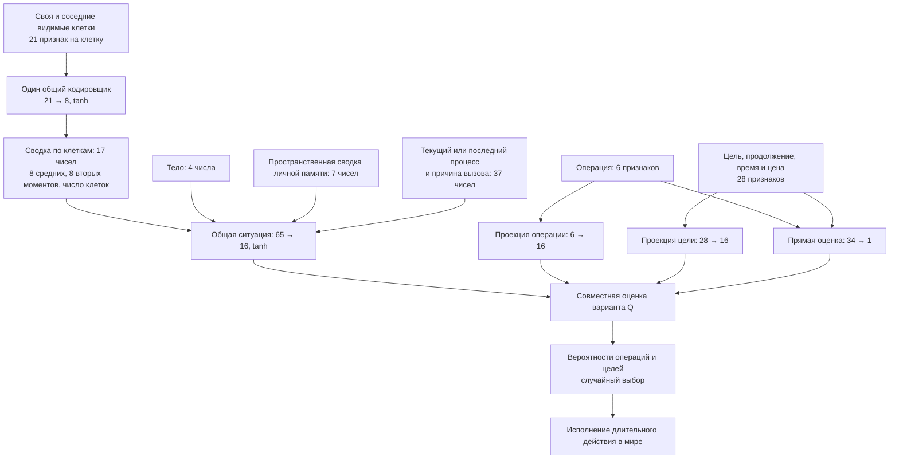
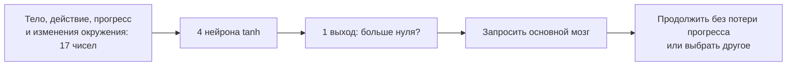

# Big Evolution: схема мозга и варианты развития на18 октября2026

## Структурная эволюция

Реализованный контракт и инструкция: [0.53](updates/v053-structural-brain.md). Ниже сохранено обсуждение и основания решений; при расхождении текущую реализацию определяет протокол выпуска и справочник механик.

### Начальная структура основателей — обсуждение

Пользователь подтвердил предложенные смыслы процентов/пустых слоёв и поручил реализацию, добавив заполнение миниатюры и около 75% экрана схемой. Выполнено: [0.53.2, действующий контракт и проверки](updates/v053-initial-structure.md). Ниже — история обсуждения, не действующий запрет реализации.

Уточнение пользователя: выбрана горизонтальная таблица после полей максимумов нейронов/слоёв. Первая строка «Слой | 1 | 2 | … | максимум», вторая «Нейроны | значения от 0 до максимума». Общая сумма ограничивается максимумом. Вместо предложенных 0–100% пользователь разрешает процент выше 100: 0 — никаких связей; 100 — последовательное соединение входов, слоёв и выходов. Пока требует определения: означает ли 100% все связи между соседними непустыми уровнями; добавляются ли сверх 100% случайные связи с пропусками; пропускать ли пустые столбцы как отсутствующие слои. Предложение агента — да для всех трёх; максимум процента вычислять по доступным уникальным связям вперёд относительно базового числа соседних, при отсутствии скрытых слоёв он равен 100%. Сумму предлагается разрешить до максимума включительно; пользовательский оборот «меньше максимального» пока не уточнён. Код не поручен. Более ранние варианты ниже — история предложений, выбор формы уже сделан.

25.10.2026, после 0.53.1. Пользователь просит обсудить варианты формы, код не поручен. Новое требование: задаваемая начальная заполненность связей 0–100% без отклонения, одинаковая настройка для основателей; начальные скрытые слои и число нейронов в каждом в пределах технических максимумов. Сумма нейронов ограничена общим максимумом, число слоёв — максимумом слоёв. Это предложение заменить нынешний случайный старт 4–6 нейронов одного полностью связанного соседними уровнями слоя, а не менять правила наследования детей.

Варианты агента для выбора: (1) строки «Слой — число нейронов», добавление/удаление слоя и автоматически показанные итоги; (2) компактная последовательность `4, 3, 2`; (3) общее число нейронов и слоёв с автоматическим равномерным распределением. Рекомендация — первый вариант; ноль скрытых слоёв задаётся удалением всех строк, пустые слои не сохраняются. Предел — потолок, заполнять его целиком не требуется.

Предложение смысла процента: точно округлённая доля от числа допустимых начальных связей, с выводом фактического количества; одинаковое количество, случайный выбор соединений/весов у разных основателей. Отдельный ещё не выбранный вопрос: считать кандидатами только связи соседних уровней, как при нынешнем старте, или любые связи вперёд, включая пропуски и вход→выход. При низкой заполненности возможны изолированные нейроны; принудительная связность конфликтовала бы с 0% и требует отдельного решения. Ноль скрытых слоёв допускает прямые вход→выход; 0% не выключает фиксированные блоки мозга. Обучение меняет веса существующих связей, отсутствующие появляются через структурные мутации.

Предлагается одна форма в стартовых условиях мира и общих условиях опыта, с возможностью сравнивать начальные структуры/проценты как факторы опыта. Для загруженного генома предлагается сохранять его структуру без наложения этих начальных настроек. Всё перечисленное, кроме запроса пользователя и отказа от отклонения, пока предложения; дождаться выбора формы и поручения реализации.

### История согласования структурной эволюции 0.53

Обсуждение 25.10.2026, без поручения реализации. Рабочая версия проверена: 0.52.2, текущая схема мозга — temporal v13. Прежняя схема ниже остаётся историческим обзором; решения и оставшиеся предложения разграничены ниже.

Пользователь предложил: случайное начальное число скрытых нейронов 4–6; добавление нейронов в имеющийся или новый скрытый слой; добавление/удаление связей; стоимость активации пропорциональна вычислительной сложности относительно нынешнего мозга; отдельное наследуемое описание/регулятор структурной эволюции, аналогично регуляторам мутаций. Не трактовать обсуждение как разрешение менять сеть.

Проверенное устройство: `temporal-layout.js` задаёт кодировщик клеток с 8 скрытыми выходами и главный контекст размером 16, согласованные проекции целей/операций; `set-brain-engine.js` переиспользует общую ситуацию между вариантами и считает обучение через те же блоки. `action-timing.js` задаёт DECISION_COST=0.10 и REPEAT_COST=0.03, `temporal-world.js` выбирает ставку и передаёт её в `energy-budget.js`. При нехватке энергии нынешняя функция списывает здоровье; новая цена должна проходить через тот же бюджет. Регуляторы частоты/силы в `mutation-parameters.js` не описывают структуру сети.

Принято пользователем:
- Начальные 4–6 скрытых нейронов относятся к главному блоку оценки. Кодировщик клеток и малая сеть вызова не включены в эту область изменения.
- Структурные изменения происходят при рождении ребёнка; в течение жизни структура сохраняется, обучение весов продолжается.
- Наследуются схема мозга и отдельный ген вероятности её изменения.
- Разрешено удалять скрытые нейроны вместе с их связями; пустые слои исчезают автоматически.
- В стоимость входят выбор действия и обучение: оплачивается вся выполненная работа основного мозга по этим задачам. При отключённом обучении отсутствующая работа не оплачивается.
- Настраиваемые технические пределы: по умолчанию до 64 скрытых нейронов суммарно в изменяемом блоке и до 4 скрытых слоёв. Это не результат замеров производительности и не требование вырасти до предела.
- Сохраняются обе нынешние ставки: 0.10 для обычного решения и 0.03 для повторения. Обе масштабируются относительно вычислительной стоимости нынешнего мозга с учётом выбора и обучения. Рекомендация единой цены операции без скидки повторения отклонена.
- Случайные основатели начинают со всех связей между соседними уровнями.
- Пользователь заменил предложение «одна структурная правка» на изменение не более одного нейрона и нескольких связей: связи могут одновременно добавляться и исчезать. Это не означает автоматическую полную связность после мутации; верхний бюджет правок связей теперь согласован отдельно: до пяти включительно.
- Пользователь повысил предел изменения связей до пяти включительно. При добавлении нейрона среди этих связей обязательны хотя бы одна входящая и одна исходящая, то есть минимальные две входят в лимит пяти. Это заменяет прежнее предложение агента учитывать подключение нового нейрона вне бюджета. Ограничение удаления связей вместе с удаляемым нейроном уточняется отдельно.
- Связи, исчезающие вместе с удаляемым нейроном, не входят в предел пяти правок остальных связей.
- Начальная наследуемая вероятность структурной мутации случайна в пределах 1–5% на рождение; точное распределение и дальнейшая мутация регулятора ещё требуют определения.
- Первый этап — без циклов; рекуррентное состояние/обучение во времени отложены. Разрешены любые связи вперёд, включая пропуски слоёв и прямые вход→выход.
- Разрешено уменьшение до нуля скрытых нейронов в изменяемом блоке; прямые пути и фиксированные части мозга остаются, работа оплачивается.
- Новая схема геномов и полных миров без преобразования старых. Старые результаты опытов остаются читаемыми; отсутствующие в них новые показатели не считать нулевыми.
Эти решения не являются поручением реализовать механизм.

Уточнение агента: начальные 4/5/6 предлагается выбирать равновероятно для случайных основателей; дети наследуют текущую структуру родителя с возможной структурной мутацией, а не заново получают 4–6. Правила для загруженных геномов ещё предстоит согласовать.

Предложения агента:
- Сначала эволюционирует основной оценщик; текущие наблюдения, кодирование клеток, память и малая сеть вызова сохраняют свои роли. Пользователь выбрал главный блок оценки; это не ограничение числа нейронов во всех остальных блоках. Изменение ширины главного блока требует согласовать проекции цели/операции.
- Наследовать структуру и исходные веса; личные поправки/память не наследовать. Структуру менять при рождении, за жизнь продолжать обучение весов. Для экономии формат исполнения собирать после рождения/структурной мутации; рабочие массивы переиспользовать, не искать порядок нейронов на каждом подшаге.
- Первая структура — направленная без циклов; допускаются прямые связи вход→выход и пропуски слоёв, но не обратные связи/самосвязи. Для нового слоя можно разделять существующую связь новым нейроном, сохраняя остальные веса; нелинейность не гарантирует точного сохранения поведения. Это известный приём [NEAT, исходная статья](https://nn.cs.utexas.edu/downloads/papers/stanley.ec02.pdf), не предложение переносить весь алгоритм со скрещиванием/искусственными видами в модель.
- Энергия: E_new = E_current × C_new / C_reference. Считать сеть и фиксированный нынешний эталон на одинаковом объёме доступных наблюдений/вариантов, иначе размер окружения смешается с размером мозга. Использовать детерминированные модельные операции, не время ПК, число генов или только нейронов. Нелинейные активации и действующие связи имеют стоимость; отсутствующая связь реально пропускается исполнителем. Сохранение двух нынешних ставок 0.10/0.03 с масштабированием обеих принято пользователем; скидка повторения остаётся отдельным правилом модели. Участие выбора и обучения в C принято пользователем. Единицы операций, калибровка и момент оплаты ещё обсуждаются.
- Разделить данные структуры (узлы/слои/связи/веса) и ген частоты структурных мутаций. Частота относится к событию на рождение, а не к каждой связи; обычная мутация весов остаётся отдельной. Рекомендация — редкие небольшие структурные изменения, без автоматического предпочтения роста. Удаление нейронов/пустых слоёв и настраиваемые пределы 64/4 приняты; распределение видов структурной мутации и её начальная частота ещё не согласованы.
- Наблюдать число нейронов/связей/глубину, расчётную цену вызова и суммарную оплату мышления; сравнивать с поведением/выживанием. Сам рост сложности не доказывает улучшение. Реальное ускорение разреженного исполнителя требует измерения; нынешние общие вычисления нельзя дублировать для каждой цели. Формат генома, обучение, валидаторы, опыты и полные сохранения потребуют нового согласованного контракта совместимости.

Пояснение учёта вычислений: после построения/мутации сети предлагается выводить коэффициенты стоимости прямого прохода, обратного прохода и обновления весов из её исполняемой структуры. В течение жизни использовать эти коэффициенты и количество обработанных клеток/вариантов/обучающих обновлений. Один неизменный счёт на всю жизнь недостаточен при переменном размере задачи; не вводить прибавление счётчика на каждое умножение и не дублировать уже общие вычисления. Детерминированная модель стоимости отделена от времени ПК, отрисовки, экспорта и диагностического наблюдения. Оплата выбора и последующего обучения может выполняться раздельно по факту работы, без повторной оплаты одного прохода; точный порядок относительно награды и дефицита предстоит определить.

Условный пример для объяснения, не замер: эталон тратит 1000 единиц на выбор и 2000 на обучение, весь цикл — 3000 и 0.10 энергии. Тогда доли цены 0.10×1000/3000 и 0.10×2000/3000; двойной объём обеих частей стоит 0.20. Эта калибровка пока рекомендация, а не утверждённая формула списания.

Ответ о цене получен: сохраняются обе ставки 0.10/0.03, обе масштабируются; предложение отменить скидку не принято. Для полного цикла с коэффициентом сложности 2 получаются соответственно 0.20/0.06, с коэффициентом 0.5 — 0.05/0.015. Разнесение оплаты выбора и обучения по моментам выполнения и согласование с наградой/энергетическим бюджетом ещё предстоит определить; при разнесении предлагается сохранять ставку соответствующего решения для его обучающего обновления.

Ответы следующей группы получены: полный старт между соседними уровнями принят; пользователь предпочитает малый пакет «не более одного нейрона + несколько добавлений/удалений связей»; про пропуски слоёв просит объяснить нюансы. Начальная вероятность 1–5% этим ответом не утверждена.

Пояснение агента: стартовая полная связность и правила мутации различны. Вновь добавленный нейрон не соединяется автоматически со всеми входами/нейронами/выходами; остальная сеть и её исходные веса сохраняются. При добавлении нейрона две обязательные связи входят в общий предел пяти; схема предложения — 2–5 правок при добавлении, до пяти при остальных изменениях, без требования обязательно использовать весь бюджет. Минимальное подключение должно образовать путь от входов через новый нейрон к выходам, а не ветку из изолированных узлов; две обязательные связи должны сохраняться после всего пакета правок. При разделении старой связи её удаление и добавление двух новых дают три правки. Допустимо смешать появления и удаления. Точное распределение числа правок пока не выбрано. Как обращаться с полностью отключившимися прежними нейронами, уточнить перед реализацией.

Обсуждение пропусков: при связях только между соседними уровнями добавление слоя затрагивает пути прохода через этот участок; нельзя незаметно переносить/удалять прежние связи ради такого ограничения. При разрешённых связях вперёд прежние пути могут сохраняться как пропуски, пока новая ветвь развивается. Прямая вход→выход даёт короткий обучаемый вклад в выход изменяемого блока, не готовую команду особи и не новые сведения. Это может позволить эволюции обойти ненужные скрытые слои; рост глубины не гарантируется. Дополнительные связи увеличивают оплачиваемую работу. Обратные связи/циклы требуют определить время сигнала, внутреннее состояние и обучение; в этот этап агент рекомендует их не включать. Выбор между соседними уровнями и любыми связями вперёд ещё открыт; рекомендация — разрешить пропуски и вход→выход без циклов. Входы и выходы — фиксированный интерфейс; их число/семантику структурная мутация не меняет.

Ответы получены: связи удаляемого нейрона вне лимита пяти, начальный ген вероятности случайно 1–5%. Обсуждение циклов завершилось выбором первого этапа без них; справка сохранена ниже.

Циклы отложены по решению пользователя. [Пояснение о пользе/стоимости рекуррентности](#циклы-отложенное-обсуждение) сохранено отдельно от объёма первого этапа.

Все три ответа получены: любые связи вперёд с пропусками, минимум скрытых нейронов 0, новая схема геномов/миров без преобразования при сохранении чтения старых отчётов. Ноль скрытых нейронов не означает исчезновение остальных блоков или бесплатный вызов.

Уточнение 25.10.2026: пользователь в целом согласился с оставшимся пакетом; инициализация новых элементов принята условно — при небольшом изменении поведения. Распределения: при структурном событии равновероятно «без изменения нейрона / добавить / удалить»; самостоятельные добавления/удаления связей равновероятны; число правок случайно в допустимом диапазоне до пяти, обязательные две при добавлении включены. Новый слой или расширение имеющегося выбираются без предпочтения среди допустимых вариантов. Недопустимую операцию на границе пропускать, не обходя предел и не заменяя удаление ростом. Прежние веса не пересоздавать. Вероятность события относится к рождению; отключение общих мутаций отключает структурные, отдельное отключение структурных сохраняет обычные мутации весов.

Также принят общий принцип: отключившиеся участки генома не удалять автоматически сверх лимита одного нейрона; части, структурно не способные влиять на выход, не выполнять и не оплачивать. Показывать общее и действующее число элементов. Нулевой вес существующей обучаемой связи не означает структурного отключения: её вычисления и возможность обучения сохраняются. Выход со смещением/постоянным вкладом не считать отсутствующим вычислением. Полный граф хранить в геноме/полном мире, в истории жизней — компактные показатели структуры/затрат без копирования всех связей каждой особи.

Порядок оплаты в целом принят: выбор и обучение оплачивать при фактическом выполнении, обучение — со ставкой исходного решения; доли 0.10/0.03 калибровать на одном нынешнем эталоне и одинаковом размере задачи. Точные единицы операций, коэффициенты и порядок относительно подкрепления ещё требуется закрепить в техническом контракте; это не поручение менять действующий бюджет.

Итоговая инициализация: последним ответом пользователь заменил малый ненулевой исходящий вес на нулевой. При добавлении сохраняются старые пути, входящая связь нового нейрона ненулевая, исходящая первоначально нулевая; существующая нулевая связь обучается за жизнь и мутирует при наследовании. Все исходящие связи новой ветви начинают с нуля. Нормировку старых путей не менять. Это сохраняет начальные оценки при изолированном добавлении, но цена вычислений, обычные мутации и удаления могут менять поведение. Пользователь явно поручил применить обновление; статус — реализация.

Требования пользователя к наблюдению:
- Записывать среднее число связей, нейронов и слоёв, сохранять соответствующие показатели для статистики. Предложение агента: компактные признаки при рождении для существующих фильтров/весов и временных групп; отдельно различать изменяемый блок и фиксированные части, общие и действующие элементы. Семантику выборки явно подписать, не подменять её численностью живых на шаге.
- «Мир → Житель → Свойства мозга» заменить визуальной вкладкой «Схема мозга»: ряды нейронов, соединения выбранной особи. По возможности щелчок по нейрону/связи открывает сведения. Предложение агента: вес наследуемый/личная поправка/действующий вес, тип и слой; параметры обучения, памяти и мутаций сохранить в раскрываемых подробностях. Рисовать только открытую схему выбранной особи, без изменения мозга/RNG и без отдельного вычисления активаций ради картинки.
- «Выученные реакции» заменить «Предпочтениями»: проценты положительной/отрицательной чувствительности к энергии, здоровью и наполнению желудка. Предлагается та же шкала, что уже в `captureHeritable`: коэффициент делится на сумму абсолютных величин этих трёх коэффициентов и умножается на 100; при всех нулях — 0. Это относительный вес ощущений, не вероятность действия и не доля времени состояния. Пример +50%, −30%, +20%; абсолютная сила коэффициентов при такой нормировке скрывается, поэтому исходный коэффициент полезен в подробностях.

Реализация явно поручена последним сообщением; исторические запреты выше относятся к предыдущей стадии обсуждения. Результат и проверки будут записаны в протоколе 0.53.

Сводка обсуждения, не поручение реализовать все пункты. Работающая версия0.35.0; будущие идеи не объявляются существующими механизмами. Исторические записи в `future-ideas.md` и `roadmap.md` могут описывать более раннее состояние. Текущие правила — [справочник](mechanics-reference.md), текущий статус — [START_HERE](START_HERE.md).

## Как устроен нынешний мозг

Сверено с [temporal-layout.js](../dist/temporal-layout.js), [temporal-inputs.js](../dist/temporal-inputs.js), [set-brain-engine.js](../dist/set-brain-engine.js) и [attention-gate.js](../dist/attention-gate.js). Это схема математических зависимостей: быстрый оценщик объединяет линейные операции и не выполняет каждый изображённый блок заново для каждой цели.

Шесть операций: перемещение, подбор, еда, ожидание, рождение, выкладывание. Направление входит в цель перемещения. Q — прогноз субъективного будущего подкрепления, не вероятность. Веса контекста/цели/операции взаимодействуют покомпонентно; к сумме добавляется прямая оценка. Общая ситуация считается один раз для пакета вариантов.

Отдельная малая сеть:

Малая сеть наследуется и мутирует, но не обучается за жизнь. Её проверяют на подшагах, когда процесс допускает пересмотр; роды заблокированы от добровольного пересмотра. Физический срыв вызывает основной мозг напрямую. Основной мозг обучается в течение жизни; личные поправки/следы/память не наследуются. Память — отдельная система записей, не дополнительный скрытый слой. Основной мозг1827 параметров, малая сеть77, свойства12, регуляторы изменчивости2: всего1918 чисел генома. Эти числа описывают0.35.0, не будущий контракт.

## Изменяемые связи: дополнение пользователя

Пользователь предложил разрешить добавление/удаление связей наряду с нейронами и слоями. Это позволяет уменьшать число вычислений без обязательного удаления целого нейрона. Структурно отсутствующая связь отличается от существующей с весом0: во втором случае нынешний плотный цикл всё ещё выполняет умножение и сложение. Обнулённая связь также может снова измениться при обучении; отсутствующая возвращается только по правилам структурных изменений.

Для реальной экономии нужны компактные списки активных связей или иной формат, который их пропускает. Перестраивать рабочее представление разумно при структурной мутации, а не на каждом подшаге. Малые разреженные сети могут проиграть плотным из-за чтения индексов/дополнительных обходов; насколько окупится разреженность, установит сравнение прямого выбора, обучения и полного мира. Число удалённых связей не равно проценту ускорения игры.

Рекомендация агента теперь включает изменение связности вместе с шириной как кандидат на первый структурный эксперимент. Добавление глубины и произвольные обратные связи — другие ступени сложности. Циклы превращают сеть с прямым проходом в динамическую систему и требуют правил времени/обучения; они автоматически не включены в предложение пользователя. Сохранять блочную обработку множества клеток/целей, а не пересчитывать одинаковую ситуацию для каждой цели. Границы размера/связности/мутаций, затронутые блоки и цена ещё не согласованы.

## Сводка исправлений и направлений

| Направление | Содержание и актуальный статус |
| --- | --- |
| Масштаб графиков | Запас/энергия по включённым линиям; фиксированный предел сейчас мешает видеть изменения. Будущий патч. |
| Общий период | Два ползунка для графиков и таблицы; особи по времени рождения, показатели всей жизни; пища за то же время мира. Смысл принят. |
| Кривая дожития | X возраст, Y доля, собственное начало группы рождения при заданной ширине; штриховка неполного наблюдения одобрена. Числовой смысл неизвестного хвоста ещё определить. |
| Диагностика №148 | Частые выборы, истощение после проверки голодания, неполная оплата мышления. Наблюдение/контракт физиологии, не исправлено. |
| Энергетика и голодание | Разделить поддержание жизни и дополнительный расход действий/мышления, обсудить дефицит и урон здоровью. Будущий анализ; нынешние ставки не менять молча. |
| Структурная эволюция | Нейроны, связи, глубина; энергетическая цена, распределения структуры, просмотр конкретного мозга. Предложение, не реализация. |
| Память | Наследуемый запрос и выбор отдельных собственных записей вместо одной фиксированной сводки; намеренное запоминание как дальняя идея. Не реализовано. |
| Мотивации | Нелинейные ощущения/комфорт, отдельная сеть ощущений, приобретённые ассоциации/вкусы; удовольствие от действия отдельно. Прежняя боль удалена, автоматически не возвращать. |
| Исследование скорости | Профиль нынешнего пула, числовые буферы/копии/обмен/барьеры по узким местам, WASM/SIMD как варианты. Не обещать выигрыш по проценту CPU. |
| Режимы вычислителей | Выбор, живое переключение и сравнение на одинаковых нагрузках реализованы. Автоподбор самого быстрого/эффективного режима отложен. |
| Метрика испытаний | Действия/с обсуждались, пока шаги/с. В обеих случаях нужна одинаковая нагрузка; длительности меняют смысл счётчиков. |
| Повторяемые опыты | Расписания изобилия/дефицита/восстановления с seed и журналом фактических изменений. Предложение F33. |
| Анализ экспортов | Чтение/сравнение историй и испытаний в «Анализе», сводки многих миров/seed, полнота и незавершённые наблюдения. Графики живого мира уже есть. |
| Геномы и линии | Архив геномов умерших, несколько стартовых основ; продолжение полного мира требует отдельного снимка тела/опыта/состояния, обычный lives JSON им не является. |
| Социальное восприятие | Сводки действий/направлений на видимых клетках уже есть. Личности, стадии чужого процесса, социальная память и отношения отложены. |
| Социальные измерения | Устойчивость совместного движения, взаимодействий, влияния; отделять стаю от общей еды и причинное лидерство от положения впереди. Направление ранее обсуждалось. |
| Добровольные сигналы | Ограниченная дальность/время/цена, без врождённого значения «еда/следуй» и награды за общение. Предложение F35. |
| Передача пищи и забота | Адресная передача, зависимое детство/перенос ребёнка, защита — отдельные будущие контракты. Выкладывание уже есть. |
| Два родителя | Партнёр, согласование участия, вклад энергии и рекомбинация; различающиеся сети усложняют скрещивание. Не реализовано. |
| Конкуренция и бой | Сила/скорость/здоровье, исход борьбы за еду, затраты проигравшего, добровольный удар, визуализация/причины смерти. Без автоответа/награды за убийство. Старые числовые эскизы не контракт. |
| Разные тела и пищевые цепи | Наследуемые размеры/расходы/усвоение, мясо/гниение, возможное хищничество без заданных ролей и бесплатной энергии от потомства. Предложение F26. |
| Качество пищи | Видимые признаки разных источников и изучаемая питательность; не давать истинную ценность без опыта. Предложение F34. |
| Редактирование среды | Кисть/отдельные островки, небольшие случайные перестановки/изменения пищевых условий; ручные общие настройки уже есть. |
| Биомы и обзор | Лес/равнины с разным обзором; заслонение/цены/сведения требуют контракта. |
| Большой мир | Изоляция/расселение/вторичный контакт, генерация соседних территорий/движущееся окно; выход из окна не считать смертью. |
| Живые растения | Собственная генетика, ограниченные ресурсы, рост/семена/смерть вместо бесконечного источника. Большой отдельный этап. |
| Старение и развитие | Износ/восстановление, долгожительство, личные навыки, качество жизни и стадии детства/зрелости. Не наследовать приобретённое. |
| Ручное управление | Управление существующей особью и выбор обучения на вмешательствах; реальная физиология/время/пометки опыта. Не реализовано. |
| Другие действия | Уничтожение еды (выкладывание есть), строительство/технологии, обучение других/культура; дальние предложения. |
| Запуск | Pages workflow есть, работоспособность после пересоздания репозитория отдельно проверить по поручению. PWA/офлайн/desktop/.cmd — будущие варианты, не гарантии скорости/фонового выполнения. |
| Другая модель времени/пространства | Непрерывные координаты и время — отдельная будущая ветка; текущая линия сохраняет гексы и10 подшагов/Т. |

Реализованные пожелания не являются долгом нового патча: видимость пустых источников, подшаги/длительности/прерывания/стоимость выбора/гибкий лимит родов, удаление риска/боли, восприятие действий, отделение UI, параллельный основной мозг/выбор вычислителей, контрастные чекбоксы, крупные круглые ползунки/центральный максимум300, единые тексты и динамическая версия, четыре статистики историй/таблица50 строк/средняя пища. Архивные серии испытаний остаются отдельным предложением интерфейса; сами старые снимки сохранены. Это сводка реализации, не заявление о новом ручном тестировании всех элементов18 октября.

## Рекомендуемый порядок — предложение агента

1. Небольшой патч истории: шкалы, общий период, отдельная кривая дожития. Это завершает понятность наблюдения без новой физиологии.
2. Согласовать энергетику №148/нулевой энергии и выполнимость оплаты мышления. Без этого цена сложности будет неполным фактором отбора.
3. Приоритетная развилка: эксперимент изменяемой связности/ширины + цена + просмотр/статистика мозга; либо сначала проверить социальную пользу нынешних сетей в повторяемой среде. Не совмещать оба изменения в одном сравнении. Глубину оставить следующей ступенью, если не выбрана как главный предмет опыта.
4. Социальные наблюдения/измерения и один способ взаимодействия по выявленной нехватке (передача пищи или сигнал), без готовой стратегии/награды за стаю.
5. Лишь затем объединять более тяжёлые тела, бой, детство, растения и новые масштабы мира. Оптимизация — параллельный вопрос по текущему измеренному узкому месту, без скрытой смены механики.

Новая конкретная идея агента, которой не было отдельным пунктом списка: парный контроль доступности социальных сведений на одинаковых начальных состояниях и геномах. Сравнить обычное восприятие с экспериментальным исключением признаков чужих действий, явно маркируя изменение условий. Значимость высокая для проверки пользы социального восприятия, но это оценка эксперимента, не доказательство индивидуального лидерства. При развитии миров траектории разойдутся, результаты усреднять по нескольким seed/основам; один парный запуск причинный вывод о стае не подтверждает. Такой эксперимент пока только предложен; существующие входы/модель не изменены.

Новых игровых механик сверх сводки агент сейчас не рекомендует. Размер мозга, сложность мира и размер группы сами по себе не являются критерием прогресса к стае.

## Циклы: отложенное обсуждение

Не входит в первый этап по последующему решению пользователя «пока что без циклов».

Пояснение о циклах (обсуждение, не принятое устройство):
- Рекуррентная связь с явной задержкой переносит прежнюю активацию в следующий вызов; сеть получает личное внутреннее состояние, которое может сжимать последовательность наблюдений. Это возможное дополнение к нынешней пространственной памяти/признакам процесса, а не замена и не гарантия улучшения. Источник: [Deep Learning, глава о RNN](https://www.deeplearningbook.org/contents/rnn.html).
- Один шаг такого состояния требует обхода действующих прямых и рекуррентных связей и обновления активаций: порядок O(E+R+H) для разреженного исполнения. Нет необходимости бесконечно гонять сигнал по кругу. Пример плотных дополнительных связей между H узлами — до H² при разрешённых самосвязях (для 64 это 4096), что не является прогнозом времени игры. Счёт/цена следуют реально выбранному числу связей и этапов.
- Другой смысл — несколько внутренних итераций на один выбор. K проходов дают работу порядка K(E+R+H); без предела повторять «до успокоения» нельзя, сходимость не гарантирована. Агент не рекомендует этот вариант для первого этапа.
- Полезное обучение влиянию состояния через последовательность решений требует согласовать временной градиент. При выбранном варианте обучения после каждого решения через окно K прошлых вызовов дополнительная работа одного обновления растёт с окном, нужно хранить состояния/необходимые входы. Это свойство предложенной схемы с окном, не обязательная K-кратная цена любого метода или всей игры. Нынешний `setGradient` считает один сохранённый вход без разворачивания рекуррентной динамики; обычные eligibility-следы параметров не заменяют производную зависимости состояния. Источники: [глава RNN](https://www.deeplearningbook.org/contents/rnn.html), [Pascanu et al., 2013](https://arxiv.org/abs/1211.5063).
- Возможные эффекты: различная реакция на одинаковое текущее наблюдение после разной истории, сохранение краткого контекста; также инерция/колебания состояния, забывание и трудности исчезающих/взрывающихся градиентов. Это гипотезы для новой модели, не наблюдение нынешних особей и не обещание социальной стратегии.
- Для проекта рекомендация: если вводить рекуррентность, обновлять общее состояние один раз на фактический вызов основного мозга и одинаково использовать его для всех кандидатов. Не обновлять по каждой цели/порядку обхода и не запускать весь мозг каждый подшаг ради циклов. Личное состояние сохраняется в полном мире, не наследуется с геномом. Нужно определить сброс при рождении, часы/интервалы, обучение и цену; диагностика/наблюдение не должны продвигать состояние.
- Агент рекомендует два проверяемых этапа: сначала изменяемая структура со связями вперёд, затем опциональные связи с задержкой и сопоставимый опыт. Это рекомендация; пользователь ещё не выбрал наличие/тип циклов и не поручил реализацию.
