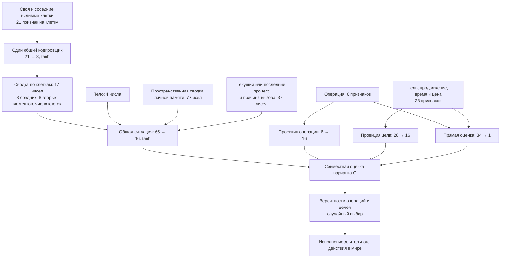
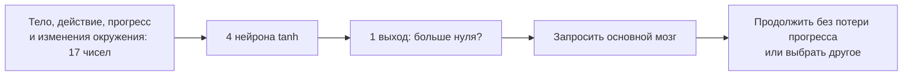

# Big Evolution: схема мозга и варианты развития на18 октября2026

Сводка обсуждения, не поручение реализовать все пункты. Работающая версия0.35.0; будущие идеи не объявляются существующими механизмами. Исторические записи в `future-ideas.md` и `roadmap.md` могут описывать более раннее состояние. Текущие правила — [справочник](mechanics-reference.md), текущий статус — [START_HERE](START_HERE.md).

## Как устроен нынешний мозг

Сверено с [temporal-layout.js](../dist/temporal-layout.js), [temporal-inputs.js](../dist/temporal-inputs.js), [set-brain-engine.js](../dist/set-brain-engine.js) и [attention-gate.js](../dist/attention-gate.js). Это схема математических зависимостей: быстрый оценщик объединяет линейные операции и не выполняет каждый изображённый блок заново для каждой цели.

Шесть операций: перемещение, подбор, еда, ожидание, рождение, выкладывание. Направление входит в цель перемещения. Q — прогноз субъективного будущего подкрепления, не вероятность. Веса контекста/цели/операции взаимодействуют покомпонентно; к сумме добавляется прямая оценка. Общая ситуация считается один раз для пакета вариантов.

Отдельная малая сеть:

Малая сеть наследуется и мутирует, но не обучается за жизнь. Её проверяют на подшагах, когда процесс допускает пересмотр; роды заблокированы от добровольного пересмотра. Физический срыв вызывает основной мозг напрямую. Основной мозг обучается в течение жизни; личные поправки/следы/память не наследуются. Память — отдельная система записей, не дополнительный скрытый слой. Основной мозг1827 параметров, малая сеть77, свойства12, регуляторы изменчивости2: всего1918 чисел генома. Эти числа описывают0.35.0, не будущий контракт.

## Изменяемые связи: дополнение пользователя

Пользователь предложил разрешить добавление/удаление связей наряду с нейронами и слоями. Это позволяет уменьшать число вычислений без обязательного удаления целого нейрона. Структурно отсутствующая связь отличается от существующей с весом0: во втором случае нынешний плотный цикл всё ещё выполняет умножение и сложение. Обнулённая связь также может снова измениться при обучении; отсутствующая возвращается только по правилам структурных изменений.

Для реальной экономии нужны компактные списки активных связей или иной формат, который их пропускает. Перестраивать рабочее представление разумно при структурной мутации, а не на каждом подшаге. Малые разреженные сети могут проиграть плотным из-за чтения индексов/дополнительных обходов; насколько окупится разреженность, установит сравнение прямого выбора, обучения и полного мира. Число удалённых связей не равно проценту ускорения игры.

Рекомендация агента теперь включает изменение связности вместе с шириной как кандидат на первый структурный эксперимент. Добавление глубины и произвольные обратные связи — другие ступени сложности. Циклы превращают сеть с прямым проходом в динамическую систему и требуют правил времени/обучения; они автоматически не включены в предложение пользователя. Сохранять блочную обработку множества клеток/целей, а не пересчитывать одинаковую ситуацию для каждой цели. Границы размера/связности/мутаций, затронутые блоки и цена ещё не согласованы.

## Сводка исправлений и направлений

| Направление | Содержание и актуальный статус |
| --- | --- |
| Масштаб графиков | Запас/энергия по включённым линиям; фиксированный предел сейчас мешает видеть изменения. Будущий патч. |
| Общий период | Два ползунка для графиков и таблицы; особи по времени рождения, показатели всей жизни; пища за то же время мира. Смысл принят. |
| Кривая дожития | X возраст, Y доля, собственное начало группы рождения при заданной ширине; штриховка неполного наблюдения одобрена. Числовой смысл неизвестного хвоста ещё определить. |
| Диагностика №148 | Частые выборы, истощение после проверки голодания, неполная оплата мышления. Наблюдение/контракт физиологии, не исправлено. |
| Энергетика и голодание | Разделить поддержание жизни и дополнительный расход действий/мышления, обсудить дефицит и урон здоровью. Будущий анализ; нынешние ставки не менять молча. |
| Структурная эволюция | Нейроны, связи, глубина; энергетическая цена, распределения структуры, просмотр конкретного мозга. Предложение, не реализация. |
| Память | Наследуемый запрос и выбор отдельных собственных записей вместо одной фиксированной сводки; намеренное запоминание как дальняя идея. Не реализовано. |
| Мотивации | Нелинейные ощущения/комфорт, отдельная сеть ощущений, приобретённые ассоциации/вкусы; удовольствие от действия отдельно. Прежняя боль удалена, автоматически не возвращать. |
| Исследование скорости | Профиль нынешнего пула, числовые буферы/копии/обмен/барьеры по узким местам, WASM/SIMD как варианты. Не обещать выигрыш по проценту CPU. |
| Режимы вычислителей | Выбор, живое переключение и сравнение на одинаковых нагрузках реализованы. Автоподбор самого быстрого/эффективного режима отложен. |
| Метрика испытаний | Действия/с обсуждались, пока шаги/с. В обеих случаях нужна одинаковая нагрузка; длительности меняют смысл счётчиков. |
| Повторяемые опыты | Расписания изобилия/дефицита/восстановления с seed и журналом фактических изменений. Предложение F33. |
| Анализ экспортов | Чтение/сравнение историй и испытаний в «Анализе», сводки многих миров/seed, полнота и незавершённые наблюдения. Графики живого мира уже есть. |
| Геномы и линии | Архив геномов умерших, несколько стартовых основ; продолжение полного мира требует отдельного снимка тела/опыта/состояния, обычный lives JSON им не является. |
| Социальное восприятие | Сводки действий/направлений на видимых клетках уже есть. Личности, стадии чужого процесса, социальная память и отношения отложены. |
| Социальные измерения | Устойчивость совместного движения, взаимодействий, влияния; отделять стаю от общей еды и причинное лидерство от положения впереди. Направление ранее обсуждалось. |
| Добровольные сигналы | Ограниченная дальность/время/цена, без врождённого значения «еда/следуй» и награды за общение. Предложение F35. |
| Передача пищи и забота | Адресная передача, зависимое детство/перенос ребёнка, защита — отдельные будущие контракты. Выкладывание уже есть. |
| Два родителя | Партнёр, согласование участия, вклад энергии и рекомбинация; различающиеся сети усложняют скрещивание. Не реализовано. |
| Конкуренция и бой | Сила/скорость/здоровье, исход борьбы за еду, затраты проигравшего, добровольный удар, визуализация/причины смерти. Без автоответа/награды за убийство. Старые числовые эскизы не контракт. |
| Разные тела и пищевые цепи | Наследуемые размеры/расходы/усвоение, мясо/гниение, возможное хищничество без заданных ролей и бесплатной энергии от потомства. Предложение F26. |
| Качество пищи | Видимые признаки разных источников и изучаемая питательность; не давать истинную ценность без опыта. Предложение F34. |
| Редактирование среды | Кисть/отдельные островки, небольшие случайные перестановки/изменения пищевых условий; ручные общие настройки уже есть. |
| Биомы и обзор | Лес/равнины с разным обзором; заслонение/цены/сведения требуют контракта. |
| Большой мир | Изоляция/расселение/вторичный контакт, генерация соседних территорий/движущееся окно; выход из окна не считать смертью. |
| Живые растения | Собственная генетика, ограниченные ресурсы, рост/семена/смерть вместо бесконечного источника. Большой отдельный этап. |
| Старение и развитие | Износ/восстановление, долгожительство, личные навыки, качество жизни и стадии детства/зрелости. Не наследовать приобретённое. |
| Ручное управление | Управление существующей особью и выбор обучения на вмешательствах; реальная физиология/время/пометки опыта. Не реализовано. |
| Другие действия | Уничтожение еды (выкладывание есть), строительство/технологии, обучение других/культура; дальние предложения. |
| Запуск | Pages workflow есть, работоспособность после пересоздания репозитория отдельно проверить по поручению. PWA/офлайн/desktop/.cmd — будущие варианты, не гарантии скорости/фонового выполнения. |
| Другая модель времени/пространства | Непрерывные координаты и время — отдельная будущая ветка; текущая линия сохраняет гексы и10 подшагов/Т. |

Реализованные пожелания не являются долгом нового патча: видимость пустых источников, подшаги/длительности/прерывания/стоимость выбора/гибкий лимит родов, удаление риска/боли, восприятие действий, отделение UI, параллельный основной мозг/выбор вычислителей, контрастные чекбоксы, крупные круглые ползунки/центральный максимум300, единые тексты и динамическая версия, четыре статистики историй/таблица50 строк/средняя пища. Архивные серии испытаний остаются отдельным предложением интерфейса; сами старые снимки сохранены. Это сводка реализации, не заявление о новом ручном тестировании всех элементов18 октября.

## Рекомендуемый порядок — предложение агента

1. Небольшой патч истории: шкалы, общий период, отдельная кривая дожития. Это завершает понятность наблюдения без новой физиологии.
2. Согласовать энергетику №148/нулевой энергии и выполнимость оплаты мышления. Без этого цена сложности будет неполным фактором отбора.
3. Приоритетная развилка: эксперимент изменяемой связности/ширины + цена + просмотр/статистика мозга; либо сначала проверить социальную пользу нынешних сетей в повторяемой среде. Не совмещать оба изменения в одном сравнении. Глубину оставить следующей ступенью, если не выбрана как главный предмет опыта.
4. Социальные наблюдения/измерения и один способ взаимодействия по выявленной нехватке (передача пищи или сигнал), без готовой стратегии/награды за стаю.
5. Лишь затем объединять более тяжёлые тела, бой, детство, растения и новые масштабы мира. Оптимизация — параллельный вопрос по текущему измеренному узкому месту, без скрытой смены механики.

Новая конкретная идея агента, которой не было отдельным пунктом списка: парный контроль доступности социальных сведений на одинаковых начальных состояниях и геномах. Сравнить обычное восприятие с экспериментальным исключением признаков чужих действий, явно маркируя изменение условий. Значимость высокая для проверки пользы социального восприятия, но это оценка эксперимента, не доказательство индивидуального лидерства. При развитии миров траектории разойдутся, результаты усреднять по нескольким seed/основам; один парный запуск причинный вывод о стае не подтверждает. Такой эксперимент пока только предложен; существующие входы/модель не изменены.

Новых игровых механик сверх сводки агент сейчас не рекомендует. Размер мозга, сложность мира и размер группы сами по себе не являются критерием прогресса к стае.
